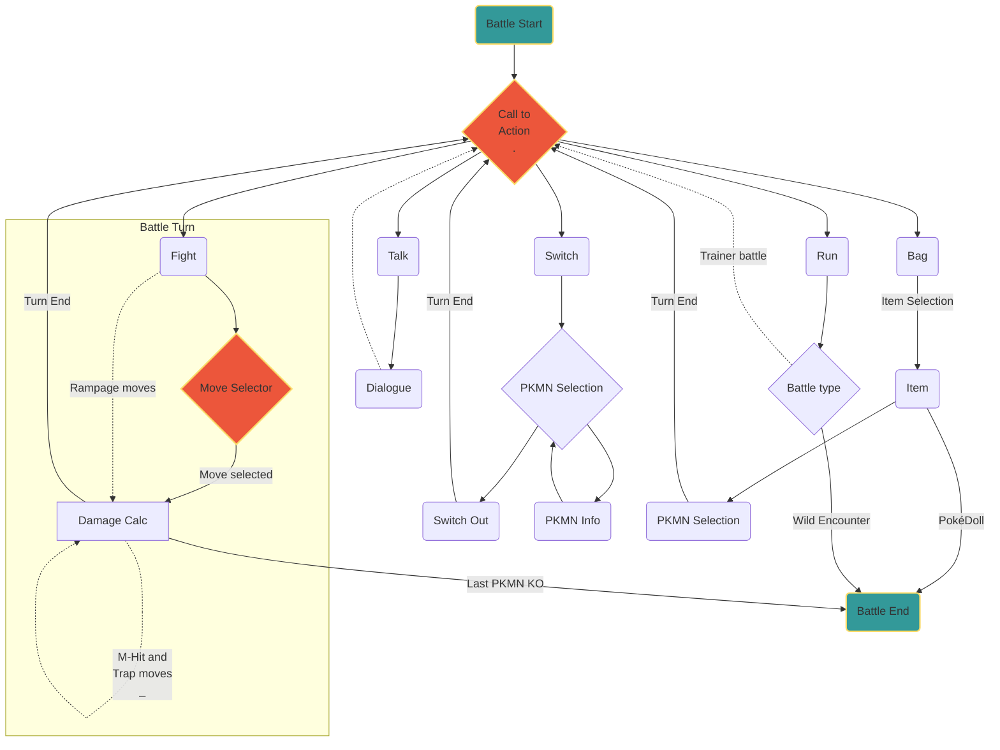

CREATOR: PrimordialRune;
ROM BASE: Pokémon Emerald (US);
LANGUAGE: ITA, ENG; 

## Abstract

---

Il gioco "Pocket Monsters: Minamoto" nasce con l'intento di eseguire un'opera di redesign più completa possibile dei primi due titoli della serie Pokémon, ovvero "Pokémon Rosso" e "Pokémon Verde". L'obiettivo è di ripristinare il contenuto originale che è andato perduto durante lo sviluppo dei giochi e che è stato oggetto di teorie da parte dei fan. Il redesign si concentra sulla grafica di gioco, la storia e diverse meccaniche, che subiranno enormi variazioni rispetto ai giochi originali pur mantenendo il sentimento retrò e di nostalgia che caratterizza le prime generazioni di Pokémon.

Il redesign di "Pocket Monsters: Minamoto" rappresenta un'evoluzione del gameplay della serie Pokémon, introducendo nuove meccaniche di gioco e offrendo nuove opportunità strategiche ai giocatori.

## Accenni di Storia

---

Il gioco narra la storia del giovane Satoshi, un ragazzo di Masara Town che ha appena completato l'addestramento per diventare allenatore. Contattato dal Dr. Okido, un illustre ricercatore di Pocket Monsters nella sua città, riceve l'incarico di catalogare diverse specie della regione del Kanto in un'enciclopedia digitale chiamata PokeMon Index.

Al fine di raccogliere il maggior numero possibile di dati, parte per un viaggio attraverso l'intera regione del Kanto, accompagnato all'inizio da Ken e Shigeru, i nipoti del Dr. Okido, che successivamente intraprendono le loro rispettive strade.

## Mondo di Gioco

---

## Meccaniche Base

---

Il gioco segue le meccaniche tipiche dei giochi di ruolo giapponesi (JRPG), ovvero un gioco di avventura in cui il giocatore controlla un gruppo di personaggi e si avventura in un mondo fantastico, affrontando nemici e risolvendo enigmi.

Il gioco include un sistema di combattimento a turni in stile Pokémon, in cui il giocatore utilizza una squadra di Pocket Monster per sfidare gli avversari. Inoltre, il gioco presenta una vasta gamma di mosse e abilità, che possono essere utilizzate per sconfiggere i nemici e superare gli ostacoli.

### Core Loop

---

Il core loop del gioco si basa sulla progressione del personaggio e sul senso di soddisfazione derivante dall'affrontare sfide sempre più difficili e complesse. Ciò viene ottenuto ponendo una serie di obiettivi che il giocatore deve raggiungere, come la cattura di tutti i Pocket Monster per il completamento del PokéDex o la sconfitta dei vari boss presenti nella regione.

Il core loop del gioco si basa sulla ripetizione di alcune attività fondamentali. Tali attività includono:

- Esplorazione del mondo di gioco
    - Scoperta di nuove aree e ricerca di oggetti utili
    - Interazione con personaggi non giocabili (NPC) al fine di acquisire informazioni e missioni secondarie
- Scontri tra Pocket Monsters
    - Confronto con nemici, ovvero allenatori e Pocket Monsters selvatici
    - Possibilità di catturare Pocket Monsters selvatici per arricchire la propria squadra
    - Scelta strategica di mosse in base ai differenti tipi di nemici, tenendo in considerazione le debolezze e le resistenze dei Pocket Monsters avversari
    - Utilizzo mirato degli oggetti disponibili per potenziare i propri Pocket Monsters o per interagire con il mondo di gioco
    - Incremento del livello dei Pocket Monsters catturati per aumentare le possibilità di vittoria e apprendere nuove mosse
- Progressione del gioco
    - Risoluzione di enigmi e missioni secondarie al fine di avanzare nella trama principale del gioco
    - Sconfitta di boss (capipalestra) per ottenere medaglie e accedere a nuove aree
    - Sfide di livello avanzato, come i Four Heavenly Kings o i Pocket Monsters Illusori, che richiedono una strategia affinata e un utilizzo ottimale delle mosse e delle statistiche del proprio Pocket Monster per vincere.

Il giocatore viene incentivato a ripetere tali attività per tutta la durata del gioco al fine di accrescere la propria squadra di Pocket Monsters, migliorare le proprie abilità di allenamento e progredire nella trama principale del gioco. Il gameplay si basa sulla varietà e la complessità degli scontri tra Pocket Monsters e sull'esplorazione del mondo di gioco, in grado di mantenere l'interesse del giocatore sui contenuti del gioco.

### Input e Funzionalità

---

- 【 ▴ ▾ ◂ ▸ 】
    
    I tasti direzionali costituiscono l'input principale per il controllo del personaggio all'interno del gioco. Sono responsabili della gestione del movimento del personaggio e consentono al giocatore di esplorare l'ambiente di gioco e interagire con gli oggetti presenti. L'input direzionale è vincolato alle quattro direzioni cardinali e viene utilizzato anche per la navigazione all'interno delle interfacce e dei menu di gioco.
    
- 【 🇦 】
    
    Il tasto 【 🇦 】 permette al giocatore di interagire con gli oggetti presenti nel mondo di gioco, come le casse o i NPC. Inoltre, durante le battaglie e nelle altre interfacce di gioco, il tasto 【 🇦 】 viene utilizzato per confermare una scelta.
    
- 【 🇧 】
    
    Il tasto 【 🇧 】 viene utilizzato per annullare le azioni, come ad esempio per uscire da una conversazione con un NPC o per annullare la scelta di una mossa durante una battaglia. Inoltre, il tasto 【 🇧 】 viene utilizzato per la corsa, che consente al personaggio di muoversi più velocemente all'interno del mondo di gioco.
    
- 【 🇸 🇹 🇦 🇷 🇹 】
    
    Il tasto 【 🇸 🇹 🇦 🇷 🇹 】 viene utilizzato per aprire il menu del gioco, che consente al giocatore di accedere a diverse funzionalità come la visualizzazione dello stato dei Pocket Monster o l'utilizzo degli oggetti. Inoltre, il tasto 【 🇸 🇹 🇦 🇷 🇹 】 viene utilizzato per avviare il gioco.
    
- 【 🇸 🇪 🇱 🇪 🇨 🇹 】
    
    Il tasto 【 🇸 🇪 🇱 🇪 🇨 🇹 】 viene utilizzato per accedere a funzionalità aggiuntive del gioco, come la visualizzazione della mappa della regione o la selezione del Pocket Monster attivo durante le battaglie. Inoltre, il tasto 【 🇸 🇪 🇱 🇪 🇨 🇹 】 viene utilizzato per annullare le scelte effettuate all'interno del menu del gioco.
    
- 【 🇱 】
    
    Il tasto 【 🇱 】 viene utilizzato per accedere a funzioni aggiuntive del gioco.
    
- 【 🇷 ****】
    
    Il tasto 【 🇷 ****】 viene utilizzato per accedere a funzioni aggiuntive del gioco.
    

### Esperienza di Gioco e Tecniche di Coinvolgimento

---

Il gioco implementa una serie di tecniche di engagement volte a stimolare il giocatore a intrattenersi con il gioco e a perseguire gli obiettivi di gioco. Queste tecniche sono fondamentali per mantenere il giocatore impegnato e motivato a lungo termine e sono basate su principi psicologici, comportamentali e di design.

- Rinforzo positivo (o Skinner Box)
    
    La tecnica del rinforzo positivo viene utilizzata per incentivare il giocatore a ripetere determinate attività all'interno del gioco, fornendo una ricompensa o un feedback positivo.  Questa tecnica si basa sulla teoria dell'apprendimento di Skinner, che sostiene che i comportamenti premiati sono più probabili di essere ripetuti in futuro. Nel gioco, il rinforzo positivo viene fornito sotto forma di oggetti e denaro che possono essere utilizzati per facilitare la progressione del gioco. Alcuni esempi di Skinner Box includono:
    
    - Cattura di Pocket Monsters
        
        La cattura di Pocket Monsters rappresenta una Skinner Box fondamentale all'interno del gioco. Incentivando il giocatore a catturare il maggior numero possibile di Pocket Monsters, il gioco fornisce un feedback positivo sotto forma di nuovi Pokémon da aggiungere alla propria squadra e al PokéDex. Il gioco presenta inoltre una vasta gamma di Pocket Monsters, ognuno con abilità e statistiche uniche, che stimolano il giocatore a continuare a catturare Pocket Monsters per ottenere una squadra sempre più forte e variegata.
        
    - Progressione del livello
        
        Il gioco utilizza una Skinner Box basata sulla progressione del livello. Il giocatore viene incentivato a continuare a giocare e a superare le sfide successive per aumentare il livello dei propri Pocket Monsters. Il gioco fornisce un feedback positivo sotto forma di nuove mosse sbloccate e un aumento alle statistiche al raggiungimento di determinati livelli, stimolando il giocatore a progredire nella trama principale e a completare le missioni secondarie.
        
    - Sfide di livello avanzato
        
        Il gioco include diverse Skinner Box incentrate sulle sfide di livello avanzato, come i Four Heavenly Kings o i Pocket Monsters Illusori. Queste sfide richiedono una strategia affinata e un utilizzo ottimale delle mosse e delle statistiche dei propri Pocket Monster per vincere. Il gioco fornisce un feedback positivo sotto forma di ricompense speciali, come oggetti o Pocket Monsters rari, che stimolano il giocatore a completare queste sfide e a migliorare le proprie abilità di gioco.
        
- Progressione graduale (Flow)
    
    La progressione graduale delle sfide, basata sulla teoria del flow di Csikszentmihalyi, per la quale la soddisfazione del giocatore aumenta con la difficoltà della sfida, a patto che questa non sia troppo facile o troppo difficile. Ciò è ottenuto attraverso l'incremento graduale del livello dei nemici e l'aumento della complessità delle missioni secondarie, mantenendo la sfida sempre al giusto equilibrio. Questa progressione graduale delle sfide, basata sulla teoria dell'autoefficacia di Bandura, che sostiene che la fiducia del giocatore nelle proprie abilità aumenta quando si confronta con sfide sempre più difficili, porta ad un senso di realizzazione e soddisfazione personale. Inoltre, stimola ulteriormente il giocatore a perseguire i propri obiettivi e aumenta la motivazione intrinseca del giocatore a lungo termine.
    
- Variazione casuale
    
    Il gioco utilizza la tecnica della variazione casuale per rendere il gioco meno prevedibile e più stimolante per il giocatore. Questa tecnica si basa sulla teoria dell'attesa variabile di Skinner, che sostiene che i comportamenti ripetuti in attesa di una ricompensa casuale sono più resistenti all'estinzione. Nel gioco, la variazione casuale è ottenuta attraverso la variazione del calcolo del danno delle mosse e della probabilità di esecuzione di un colpo critico.
    
- Obiettivi specifici
    
    L'obiettivo principale è la cattura di tutti i Pocket Monsters e la vittoria della lega della regione. Questo obiettivo specifico e sfidante, combinato con la vasta gamma di Pocket Monsters da catturare e la varietà di attività di gioco, motiva il giocatore a continuare a giocare e a progredire nella trama principale del gioco. Questa tecnica si basa sulla teoria dell'obiettivo di Locke e Latham, che sostiene che gli obiettivi specifici e sfidanti motivano di più rispetto a quelli vaghi o troppo facili e che che la partecipazione attiva del giocatore nella definizione degli obiettivi aumenta la motivazione dello stesso.
    
- Personalizzazione
    
    Il gioco include una vasta gamma di Pocket Monsters, ognuno con abilità e statistiche uniche, che consentono al giocatore di personalizzare la propria squadra e di adattarla alle proprie esigenze e preferenze di gioco. Questa tecnica si basa sulla teoria dell'autodeterminazione di Ryan e Deci, che sostiene che la motivazione del giocatore aumenta quando ha il controllo sulle proprie azioni e decisioni.
    
- Interazione ed immersione
    
    Il gioco include una vasta gamma di NPC con cui il giocatore può interagire per acquisire informazioni e missioni secondarie. Queste interazioni creano un senso di immersione nel mondo di gioco e incentivano il giocatore a esplorare e scoprire nuovi contenuti. Questa tecnica si basa sulla teoria della gamification di Deterding, che sostiene che l'interazione sociale e la scoperta di nuovi contenuti sono elementi fondamentali per creare un'esperienza di gioco coinvolgente.
    
- Sentimento di scoperta
    
    Il gioco include una vasta gamma di aree di gioco esplorabili dal giocatore, che incentivano l'esplorazione e la scoperta di nuovi contenuti. Le aree di gioco includono città ricche di NPC, percorsi ricchi di Pokémon e semplici aree di passaggio o transizione da un luogo ad un altro. Questa tecnica si basa sulla teoria della motivazione intrinseca di Ryan e Deci, che sostiene che l'esperienza di gioco è più coinvolgente quando gli utenti sono motivati dall'interesse e dalla curiosità piuttosto che dall'obbligo o dall'esternalizzazione delle loro azioni.
    

## Mappe ed Eventi

---

Le aree di gioco esplorabili da parte del giocatore vengono denominate Mappe; queste aree possono prevedere città ricche di NPCs (Non Playable Characters), percorsi ricchi di Pocket Monsters o semplici aree di passaggio o transizione da un luogo ad un altro. All’interno di una mappa possono esserci Eventi di vario genere, con evento si intende un qualsiasi set di azioni che ha inizio al fronte dell’attivazione di un trigger, che può essere fisico (Inizio di un dialogo da parte del giocatore, attivazione attraverso il calpestamento di uno specifico tile, ecc..) e/o logico (Rispettare un certo set di condizioni).

Di seguito una lista dettagliata delle mappe presenti all’interno del gioco comprensive di eventi: 

[MAPS/EVENTS](https://www.notion.so/31b3d985050a8121aea3dcc39406828f?pvs=21)

## Pocket Monsters

---

I Pocket Monsters, abbreviati anche come Pokémon, rappresentano gli strumenti con cui il giocatore può effettuare battaglie e proseguire nella sua esplorazione. Ogni Pokémon è dotato di proprietà e mosse uniche che contribuiscono a farlo percepire come unico. 

Durante l'avventura, il giocatore avrà accesso al Pocket Monster Index (o PokéDex), uno strumento che consente di registrare dati e informazioni riguardanti i Pocket Monster, utili per la progressione del gioco.

## Statistiche

---

Ogni Pocket Monster ha un insieme di proprietà numeriche, chiamate statistiche, che possono variare durante il gioco.

### Statistiche Permanenti

---

Le statistiche permanenti sono statistiche che esistono anche al di fuori della battaglia, il giocatore può tenerne costantemente traccia attraverso la visualizzazione dei dati del Pocket Monster.

| LEVEL | LV | 1-100 | Pilota le altre statistiche, l’apprendimento di mosse e l’evoluzione |
| --- | --- | --- | --- |
| EXPERIENCE | EXP | 1-6 | Erratic, Fast, Medium Fast, Medium Slow, Slow, Fluctuating |
| HEALTH POINTS | HP | 0-255 | Valore dinamico, se 0 il PokéMon viene considerato KO |
| ATTACK | ATK | 1-255 | Interagisce con DEF per il calcolo del danno |
| DEFENSE | DEF | 1-255 | Interagisce con ATK per il calcolo del danno |
| INTELLIGENCE | INT | 1-255 | Modifica la crescita dei TP ogni turno |
| SPEED | SPD | 1-255 | Determina l’ordine di turno |
| SPECIAL | SPL | 1-255 | Interagisce con se stessa per il calcolo di un danno speciale |
| COST | P$ | 1-255 | Determina il costo del Pocket Monster, valutazione di tutte le statistiche |

### Livello ed Esperienza

---

Il livello di un Pocket Monster è una statistica cruciale che determina la sua forza e l'efficacia in battaglia. È una rappresentazione dell'esperienza complessiva e della potenza del mostro, con livelli più alti che indicano un Pokémon più avanzato e temprato dalla battaglia.

Il livello di un Pocket Monster è rappresentato da un valore numerico compreso tra 1 e 100. Man mano che la creatura guadagna punti esperienza (EXP) attraverso le battaglie e altre attività, il suo livello aumenta. La quantità di punti esperienza richiesti per salire di livello varia in base alla specie del mostro e al livello corrente.
è determinata dalla curva di crescita secondo il parametro di Esperienza, detto anche EXP che non rappresenta altro che la soglia necessaria per l’aumento al livello successivo, questa può essere di sei tipi: Erratic, Fast, Medium Fast, Medium Slow, Slow e Fluctuating.

Il livello di un Pocket Monster è determinato dalla sua curva di crescita secondo il parametro di Esperienza, detto anche EXP. Esistono sei tipi di curve di crescita: Erratic, Fast, Medium Fast, Medium Slow, Slow e Fluctuating. La formula per il calcolo dell'EXP richiesto per ogni livello è determinata dalla curva di crescita corrispondente e varia in base al livello del Pokémon. Le formule per calcolare l'EXP richiesto per ogni tipo di curva di crescita sono le seguenti:

<aside>
 ERRATIC

$$
\mathsf{EXP=\begin{cases}
\frac{L^3 \times (100-L)}{50}, &\text{se } L < 50 \\
\frac{L^3 \times (150-L)}{100}, &\text{se } 50 \leq L \leq 68 \\
\frac{L^3 \times [\frac{(1911-(10 \times L))}{3}]}{100}, &\text{se } 68 \leq L \leq 98 \\
\frac{L^3 \times (160-L)}{100}, &\text{se } L > 98
\end{cases}}
$$

</aside>

<aside>
 FAST

$$
\mathsf{EXP= \frac{4 \times L^3}{5}}
$$

</aside>

<aside>
 MEDIUM FAST

$$
\mathsf{EXP=L^3}

$$

</aside>

<aside>
 MEDIUM SLOW

$$
\mathsf{EXP=\frac{6}{5} \times L^3 - 15 \times L^2 + 100 \times L - 140}
$$

</aside>

<aside>
 SLOW

$$
\mathsf{EXP=\frac{5 \times L^3}{4}}
$$

</aside>

<aside>
 FLUCTUATING

$$
\mathsf{EXP=\begin{cases}
\frac{L^3 \times ([\frac{L+1}{3}]+24}{50}, &\text{se } L < 15 \\[2ex]
\frac{L^3 \times (L+14)}{50}, &\text{se } 15 \leq L < 36 \\[2ex]
\frac{L^3 \times ([\frac{L}{2}]+32)}{50}, &\text{se } 36 \leq L< 98
\end{cases}}
$$

</aside>

Queste formule determinano la quantità di EXP richiesta per ogni livello per ogni tipo di curva di crescita.

Oltre a determinare la forza e l'efficacia di un Pocket Monster in battaglia, il livello gioca anche un ruolo nell'evoluzione. Molti Pocket Monsters richiedono un certo livello per evolversi nelle loro forme più potenti, rendendo l'aumento di livello un aspetto cruciale del gioco.

Per aumentare il livello di un Pocket Monster, il giocatore deve partecipare a battaglie e altre attività che forniscono punti esperienza. 

### Health Points

---

La statistica che contiene i punti vita del Pocket Monster, determina quanto danno può ricevere prima che vada in stato di “fainting” (o KO), possiede un valore di base definito per ogni specie di Pocket Monster ed è soggetta ad aumenti di statistica permanenti dati dagli Effort Values (o EV)

<aside>
 Per calcolare la statistica di HP occorre applicare la seguente formula:

$\mathsf{HP=\left[\frac{\left( 2 \times BASE + \frac{DV}{4}\right)\times LEVEL}{100}\right] + LEVEL+10}$

</aside>

### Statistiche di Base

---

Ogni statistica permanente impiegata durante la battaglia quindi: HP, ATK, DEF, INT, SPD e SPL possiede un valore di base che va da 1 a 255 e che viene utilizzato per il calcolo del valore attuale della statistica, sarà quindi influenzato dal livello del Pocket Monster a cui appartiene.

<aside>
 La formula generale per il calcolo di una statistica a partitre dal suo valore di base è:

$\mathsf{CurrentStat=\left[\left[\frac{\left( 2 \times BASE + \frac{DV}{4}\right)\times LEVEL}{100}\right] + 5\right]\times NATURE}$

</aside>

### Statistiche In Battaglia

---

Sono inoltre presenti statistiche che vengono impiegate solamente in battaglia e che sono nascoste al giocatore al di fuori della lotta in quanto non soggette ad alcun tipo di progressione. Queste statistiche hanno un valore che parte da 1 e cresce o decresce durante la battaglai per poi resettarsi alla fine di essa.

| ACCURACY | ACC | Determina la precisione del Pocket Monster nell’utilizzo delle mosse |
| --- | --- | --- |
| EVASION | EVN | Determina la capacita di un Pocket Monster di evitare mosse avversarie |
| CRITICAL CHANCHE | CRIT | La probabilità di eseguire un colpo critico  |

## Elenco dei Pocket Monsters

---

Ecco una lista dei PokéMon presenti all’interno del gioco: 

[PKMN INDEX](https://www.notion.so/31b3d985050a81ac8259e44e83174a7f?pvs=21)

## Mosse

---

## Cosa sono le Mosse?

---

Le mosse sono le azioni che un Pocket Monster svolge in battaglia per attaccare e difendersi. Ogni mossa presenta un TIPO, ovvero l'elemento al quale la mossa è associata, e le proprietà di POTENZA, PRECISIONE e COSTO. Le mosse vengono apprese per livello e possono essere sovrascritte o migliorate attraverso l'acquisizione di MOVE MACHINE o il completamento di specifici eventi. Esistono inoltre le mosse Signature, esclusive di una specie o di una linea evolutiva di Pocket Monsters e non soggette a sovrascrittura. Un Pocket Monster può apprendere fino a 4 mosse contemporaneamente e, una volta raggiunto il limite, il giocatore dovrà decidere quali mosse mantenere e quali far dimenticare alla propria creatura.

## Proprietà

---

### Potenza

---

Per poter discutere della potenza di una mossa è necessario definire il concetto di danno, ovvero la quantità di salute che un Pocket Monster perde a seguito dell'utilizzo di una mossa da parte dell'avversario. La potenza di una mossa indica l'entità del danno che questa può infliggere espresso in valore intero, ma tale valore è approssimativo e soggetto a una variazione casuale chiamata "Roll". Questa variabilità ha lo scopo di rendere il risultato meno prevedibile per il giocatore e di alimentare il senso di battaglia.

<aside>
 Il danno viene calcolato secondo la seguente formula:

$\mathsf{Damage=\Bigg[\frac{\left ( \frac{2\times Level}{5}+2 \right )\: \times\:  Power \: \times\:  \frac{Attack}{Defense}}{50}  \Bigg]\times Modifier}$

</aside>

Dove:

- 【Level】→ Il livello di chi attacca, compreso tra 1 e 100;
- 【Power】→ La potenza della mossa utilizzata, tra 0 e 250;
- 【Attack】→ La statistica di Attacco del Pocket Monster attaccante, inferiore a 255;
- 【Defense】→ La statistica di Difesa del Pocket Monster difensore, inferiore a 255;

Il parametro [Modifier] racchiude le varie modifiche che il danno di una mossa può subire. Esse derivano da fattori secondari come l'efficacia del tipo della mossa sferrata e altri fattori di gioco.

<aside>
 Il Modificatore è calcolato come segue:

$\mathsf{ Modifier = Badges \times Critical \times RNG \times STAB \times Type \times Other }$

</aside>

- 【Badges】→ Rappresenta un modificatore della potenza delle mosse in base alle medaglie possedute dal giocatore. Una mossa utilizzata da un Pocket Monster che appartiene al giocatore e che ha lo stesso tipo di una medaglia sconfitta ha un valore di potenza di 1,25, altrimenti il valore è 1.
- 【Critical】→ Moltiplicatore che assume il valore di 2 se la mossa è un danno critico, e di 1 in caso contrario.
- 【RNG】→ Valore determinato casualmente tra 0,85 e 1;
- 【STAB】(Same Type Attack Bonus) → Moltiplicatore di potenza delle mosse che viene applicato quando la mossa utilizzata dal Pocket Monster ha lo stesso tipo del Pokémon che l'ha usata. Il valore di questo moltiplicatore è 1,5, altrimenti è 1.
- 【Type】→ L'efficacia di una mossa contro un avversario è determinata dal tipo della mossa. Essa può essere 0 se la mossa non ha effetto, 0.25 se l'avversario è doppiamente resistente, 0.5 se resistente, 1 se efficace normalmente, 2 se superefficace e 4 se doppiamente superefficace.
- 【Other】→ Altri modificatori plausibili quali status o effetti speciali dati dalle mosse stesse.

### Precisione

---

La percentuale di Precisione di una mossa determina la probabilità con cui essa colpirà il bersaglio, ovvero il Pocket Monster avversario. Ogni mossa possiede una specifica percentuale di Precisione, che è soggetta a variazioni in base a fattori come gli aumenti o le diminuzioni alla statistica di Precisione del Pokémon attaccante e/o alla statistica di Evasione del Pokémon difensore. Inoltre, alcune mosse sono considerate "infallibili" e non richiedono il calcolo della Precisione, in quanto hanno sempre successo nell'attacco.

<aside>
 La Precisione viene calcolata attraverso la comparazione della seguente formula:

$\mathsf{ Accuracy= \left ( MoveAccuracy \times Accuracy \times Evasion \right ) \geq RNG }$

</aside>

Dove:

- 【MoveAccuracy】→ Il valore di precisione della mossa, compresa tra 1 e 100;
- 【Accuracy】→ Gli aumenti alla statistica Precisione del Pocket Monster attaccante;
- 【Evasion】→ Gli aumenti alla statistica Evasione del Pocket Monster difensore;
- 【RNG】→ Numero generato casualmente tra 1 e 100;

### Costo

---

Ogni mossa possiede un costo in Technical Points (che corrispondono a semplici Action Point per la battaglia); questi ultimi sono una proprietà dinamica del Pocket Monster in battaglia, ad inizio battaglia ogni Pocket Monster avrà a disposizione 100 Technical Points (o TP) che verranno consumati di volta in volta dal costo delle mosse e dei quali verrà recuperata una parte alla fine di ogni turno in base alla statistica di Intelligenza (o INT) del Pocket Monster. Il Costo di una mossa ha un valore che va da 5 a 100.

<aside>
 I Technical Point vengono quindi calcolati attraverso la seguente formula: 

$\mathsf{ TP= \left ( TP \: Left-Cost \right ) +5 + \frac{INT}{8}}$

</aside>

Dove:

- 【TP Left】 → Il numero di TP attuali del Pocket Monster;
- 【Cost】 → Costo in TP della mossa utilizzata dal Pocket Monster attaccante;
- 【INT】 → Parametro di Intelligenza del Pocket Monster attaccante;

## Categorie

---

### Mosse Naturali

---

Le Mosse Naturali (o Normals) sono la prima categoria di mosse, rappresentano mosse che vengono apprese normalmente durante la crescita e coinvolgono l’utilizzo di parti del corpo per arrecare danno. Le Mosse Naturali sono una delle categorie di mosse dotate di un rango mossa.

[NORMALS](https://www.notion.so/31b3d985050a81438a03c9ad8bd658c0?pvs=21)

### Mosse Elementali

---

Le Mosse Elementali (o Elementals) sono la seconda categoria di mosse, rappresentano mosse di tipo elementale che quindi sono soggette maggiormente alle clausole di efficacia ed inefficacia tra tipi; Possono essere apprese anche da Pocket Monster che non condividono il tipo della mossa qualora dovessero rispettarne i requisiti logici. Le Mosse Elementali, esattamente come le Mosse Naturali, sono una categoria di mosse dotate di un rango mossa.

[ELEMENTALS](https://www.notion.so/31b3d985050a815582b3cefdb0474352?pvs=21)

### Cos’è il Rango Mossa?

---

Il Rango Mossa è un identificatore interno alle mosse Naturali ed Elementali con alcune possibili eccezioni. Le mosse dotate di un rango mossa possono essere migliorate attraverso il level up, il miglioramento della mossa equivale all’apprendimento di una nuova mossa dotata di proprietà ed effetti differenti ma che può essere usata in sostituzione della mossa originariamente migliorata.

<aside>
 Ad esempio [FUSHIGIDANE                            ](https://www.notion.so/FUSHIGIDANE-31b3d985050a8124886ec70a3a2ef0a1?pvs=21) può apprendere [TACKLE](https://www.notion.so/TACKLE-31b3d985050a81a38998c2571781bfa9?pvs=21) dal livello 1, nel momento in cui raggiungerà il livello 20, la mossa naturale salirà di rango e sarà possibile utilizzare anche  [LUNGE](https://www.notion.so/LUNGE-31b3d985050a81b7a132e4b4c062322f?pvs=21) oltre a [TACKLE](https://www.notion.so/TACKLE-31b3d985050a81a38998c2571781bfa9?pvs=21).
Le due mosse posseggono Potenza, Costo ed effetti differenti e spetterà al giocatore scegliere strategicamente quale utilizzare in base alla situazione.

</aside>

### Mosse Signature

---

Le Signature Move (o Special Moves) sono mosse esclusive di un singolo Pocket Monster o di una specie ed esenti dal conteggio mosse che limita a 4 il numero di mosse che un Pokémon può usare contemporaneamente, una creatura potrà sempre utilizzare la sua Signature move a patto che abbia il costo per sostenerla.
Le Signature Move scalano il loro potere sulla statistica di Special del Pocket Monster attaccante attraverso un valore chiamato Special Factor (o SF).

<aside>
 Il danno di una mossa Signature sarà dunque calcolato così: 

$\mathsf{Damage=\Bigg(\frac{\left ( \frac{2\times Level}{5}+2 \right )\: \times\:  Power \: \times\:  SF}{50}  \Bigg)\times Modifier}$

Dove lo Special Factor (SF) è calcolato in questo modo:
$\mathsf{SF=\left(\frac{Attack}{Defense}\right)\times\left(\frac{SpecialAtt}{SpecialDef}\right)\times 1,15}$

</aside>

Dove:

- 【SpecialAtt】→ Statistica Special del Pocket Monster attaccante;
- 【SpecialDef】→ Statistica Special del Pocket Monster difensore;

A seguire l’elenco di tutte le mosse Signature:

[SIGNATURE](https://www.notion.so/31b3d985050a81a8bbf0e478d86d53a0?pvs=21)

### Mosse Apprendibili

---

Tutte le mosse che non appartengono alle tre categorie sopra citate, ricadono nelle Mosse Apprendibili (o Learnable Moves) ovvero mosse che possono essere apprese dai Pocket Monster attraverso l’aumento di livello e sono condivise a più specie.
Queste mosse vengono registrate attraverso particolari dischi chiamati Move Machine che ne consentono l’apprendimento forzato.

<aside>
 Un Pocket Monster può apprendere in modo naturale una Mossa Apprendibile per livello o artificialmente attraverso il consumo di una Move Machine.

</aside>

A seguire l’elenco delle mosse apprendibili tramite Move Machine:

[LEARNABLE](https://www.notion.so/31b3d985050a81638dbfe3e0f5589a31?pvs=21)

## Allenatori

---

Gli Allenatori sono personaggi non giocabili che rappresentano i nemici del giocatore e che sfidano il giocatore in una serie di battaglie tramite i loro Pocket Monster. Ogni Allenatore ha un proprio set di Pocket Monster che rappresentano un tema, come ad esempio il fuoco o Pokemon che sanno nuotare. Durante gli incontri con gli Allenatori, il giocatore può far guadagnare esperienza ai proprio pocket Monsters e ottenere oggetti utili per il proseguimento del gioco. Contro alcuni specifici allenatori il gicoatore può ottenere denaro che può spendere all’interno di Market per acquistare oggetti.
Ci sono diverse categorie di allenatori tra cui i Gym Leader e i Four Heavenly Kings che sono pensati per essere i più forti della regione del Kanto e che quindi rappresentano una grande sfida per il giocatore.

[TRAINERS](https://www.notion.so/31b3d985050a811e8ef4db525a540f3b?pvs=21)

### Carisma del Giocatore

---

Il Carisma è una proprietà dinamica del giocatore che rappresenta la sua popolarità e reputazione all'interno del mondo virtuale del gioco. Questa proprietà può essere aumentata o diminuita in base alle scelte del giocatore e alle performance in battaglia, e influisce su vari aspetti del gioco, come la disponibilità di oggetti rari, la possibilità di sfidare certi Allenatori, l'acquisizione di informazioni da parte di NPC e l'accesso a eventi speciali. Il Carisma del giocatore può anche influenzare la possibilità di incontrare e catturare Pocket Monsters illusori. Inoltre, il Carisma rappresenta una sfida parallela alla trama principale del gioco ed è un elemento importante per il completamento del gioco.

### Stato di un Allenatore

---

Lo Stato di un Allenatore è una meccanica di gioco che consente di modificare l'IA degli allenatori avversari tramite particolari interazioni in battaglia o attraverso dialoghi. L'attivazione dello Stato di un Allenatore può influenzare il comportamento dei Pocket Monster avversari o le mosse utilizzate.

Lo Stato di un Allenatore può essere attivato dal giocatore tramite l'utilizzo di una mossa o attraverso dialoghi durante la battaglia. Una volta attivato, lo Stato di un Allenatore può essere mantenuto attivo per un certo periodo di tempo, durante il quale l'IA degli allenatori avversari sarà influenzata dalle modifiche imposte dallo Stato.

Il Carisma del giocatore può influenzare l'intensità e la durata dello Stato di un Allenatore, rendendolo più o meno efficace a seconda del livello di Carisma raggiunto dal giocatore. Inoltre, lo Stato di un Allenatore può offrire vantaggi aggiuntivi al giocatore, come l'accesso a oggetti speciali.

Lo Stato di un Allenatore rappresenta una sfida aggiuntiva per il giocatore, che deve essere in grado di adattarsi alle nuove situazioni di battaglia create dalle modifiche all'IA degli allenatori avversari.

Di seguito gli stati attualmente pianificati per l’inserimento in gioco:

| Stato | Effetto |
| --- | --- |
| Berserk | L'allenatore attacca con mosse ad alto rischio e potenza |
| Analysis Paralysis | L’allenatore fa attaccare il Pokémon per ultimo, ma recupera il doppio dei TP |
| Euphoria | L'allenatore usa solo mosse superefficaci e cambia Pokémon se può usare una mossa superefficace |
| Panic | L'allenatore sceglie le mosse casualmente senza considerare la strategia |
| Focus | L'allenatore utilizza mosse con maggiore precisione anche se con meno potenza |
| Fear | L'allenatore si arrende se gli rimane un solo Pokémon |
| Resolute | L'allenatore fa attaccare il suo Pokémon per primo ma consuma il doppio dei TP |
| Overconfident | L'allenatore usa mosse e strumenti che aumentano le statistiche anche se a rischio |
| Despair | L'allenatore usa solo mosse speciali |
| Hesitant | L'allenatore cambia frequentemente Pokémon per trovare un vantaggio difensivo |
| Inspired | L'allenatore usa sempre mosse con probabilità di effetti aggiuntivi |
| Envy | L'allenatore cerca di abbassare le statistiche dell'avversario |
| Careful | L'allenatore utilizza costantemente strumenti di cura |

## Battaglia

---

Una battaglia in cui due o più Pocket Monsters si sfidano è un evento fondamentale nel gioco. Durante la battaglia, i giocatori scelgono le mosse da utilizzare in base al tipo di Pokémon avversario, alle mosse che conosce e alle statistiche del proprio Pokémon. L'obiettivo è abbattere la salute dei Pokémon avversari prima che i propri vengano sconfitti. La battaglia termina quando tutti i Pokémon di una delle parti sono sconfitti o quando un Pocket Monster si ritira attraverso la fuga. La strategia è un elemento fondamentale per la vittoria, e i giocatori devono scegliere attentamente le mosse giuste per il loro Pokémon.

### Tipi di Battaglie

---

Le battaglie tra Pocket Monsters costituiscono una delle funzionalità principali del gioco, offrendo numerose sfide e opportunità per i giocatori. Esistono diverse modalità di battaglia, ognuna delle quali presenta le proprie regole e sfide, richiedendo strategie diverse per il successo. Le battaglie possono essere giocate in vari luoghi, come in una palestra Pokemon, in una zona selvaggia o in una torre di battaglia.

Inoltre alle battaglie standard, sono presenti anche le battaglie boss, in cui il giocatore deve affrontare avversari molto più forti dei normali allenatori, come i capopalestra, i membri dei Four Heavenly Kings o i Pocket Monsters Illusori. Queste battaglie richiedono una strategia avanzata e un migliore utilizzo delle mosse e delle statistiche del proprio Pokémon per vincere. Inoltre, presentano condizioni particolari che le distinguono dalle comuni battaglie contro allenatori o Pocket Monsters selvatici.

L'elenco delle Boss Battle attualmente presenti nel gioco comprende:

[BOSS BATTLES](https://www.notion.so/BOSS-BATTLES-31b3d985050a817890a5ccc6a655c4fa?pvs=21)

### Struttura della Battaglia

---

La battaglia inizia con una chiamata all'azione, che fornisce diverse opzioni, questa è definita come l’inizio del turno:

- 【Fight】→  Durante la battaglia, il giocatore seleziona una mossa tra le quattro disponibili, o, se precedentemente ha utilizzato una mossa Rampage verrà rieseguita nuovamente dale 2 alle 3 volte saltando la fase di selezione della mossa. I Technical Points (TP) rappresentano la risorsa utilizzata per eseguire la mossa e sono una proprietà dinamica del Pocket Monster in battaglia. Una mossa può essere utilizzata solo se il Pocket Monster ha abbastanza TP disponibili (che recupera alla fine di ogni turno in base alla sua statistica di Intelligenza). La Potenza della mossa e la Precisione influenzano l'efficacia ed esecuzione dell'attacco. Vi sono anche mosse infallibili o con un danno fisso. Il danno normalmente subisce una variazione casuale chiamata ROLL, che rende il risultato della battaglia meno prevedibile. Inoltre, ci sono mosse Multi Hit, che colpiscono l'avversario più volte durante lo stesso turno, e mosse che eseguono danno ogni turno e impediscono all'avversario di cambiare il proprio Pocket Monster.
- 【Switch】→ Durante la battaglia, con questa azione il giocatore ha la possibilità di sostituire il Pocket Monster in campo con uno degli altri membri della squadra. Questa azione è possibile solo una volta per turno e consuma l'intero turno del giocatore. Lo "Switch" avviene con la massima priorità nell'ordine di esecuzione delle mosse. Il Pocket Monster in uscita viene sostituito dal Pocket Monster sostitutivo senza subire danni, ma conservando le modifiche di stato (status). Il Pocket Monster entrante non può attaccare nel turno in cui viene invocato tramite "switch". Inoltre, se il Pocket Monster in uscita è stato colpito dalla mossa di un avversario che prevede un effetto residuo, questo effetto può anche colpire il Pocket Monster sostitutivo.
- 【Talk】→ Con la pressione del pulsante R durante la fase di selezione dell’azione da eseguire in battaglia si da inizio ad un dialogo con un allenatore di Pocket Monsters, il quale permette al giocatore di ricevere suggerimenti sul comportamento e le strategie dell'avversario. Inoltre, può influenzare la statistica interna dell'allenatore chiamata "Carisma", la quale può aumentare o diminuire. Questa statistica può avere effetti sul gioco, come l'incontro con Pocket Monster illusori o l'accesso a eventi specifici.
- 【Bag】→ L'opzione permette al giocatore di utilizzare oggetti sul proprio Pocket Monster o sui restanti membri della squadra durante la battaglia. L'utilizzo di un oggetto consuma l'intero turno del giocatore e può essere effettuato solo una volta per turno. Gli oggetti utilizzabili dalla borsa includono, ma non sono limitati a: cura per la salute, ripristino dei TP, aumento temporaneo delle statistiche e molto altro. Il giocatore può portare con sé solo un numero limitato di oggetti e deve quindi scegliere strategicamente quali oggetti includere nella propria borsa prima di entrare in battaglia.
- 【Run】→ La fuga è un'opzione che permette al giocatore di uscire dalla battaglia contro un Pocket Monster selvatico. La probabilità di fuga dipende dalla velocità del Pocket Monster in battaglia e del Pocket Monster selvatico avversario.
    
    <aside>
     La formula per il calcolo delle probabilità di fuga è la seguente:
    
    $\mathsf{Escape \: Probability = \frac{UserSpeed \times 32}{(EnemySpeed \div 4) \mod 256} + 30 \times Attempts}$
    
    </aside>
    
    Dove:
    
    - $\mathsf{UserSpeed}$ è la statistica Velocità del Pokémon che cerca di fuggire
    - $\mathsf{EnemySpeed}$ è la statistica Velocità del Pokémon selvatico
    - $\mathsf{Attempts}$ è il numero di volte che si è consecutivamente tentata la fuga

Dopo aver eseguito un'azione (esclusa la conversazione), il turno del giocatore termina e questi ha la possibilità di scegliere un'altra azione durante il turno successivo. Oltre all'attacco, il giocatore ha la possibilità di effettuare uno scambio del proprio Pocket Monster, visualizzare le informazioni sui propri Pokémon o selezionare un oggetto dalla propria borsa da utilizzare durante la battaglia. Questo permette al giocatore di modificare la propria strategia di gioco e di adattarsi alle mosse dell'avversario. La scelta dell'azione successiva deve essere ponderata tenendo in considerazione le statistiche del proprio e dell'avversario, nonché le proprietà e gli effetti delle mosse disponibili.

Durante la battaglia è possibile che si verifichino condizioni di fine, come ad esempio il KO dell'ultimo Pocket Monster o la fuga di una delle due parti. Inoltre, il dialogo durante la battaglia può fornire informazioni sulle mosse e le strategie dell'avversario, migliorando la capacità di combattimento del giocatore.

## Estetica

---

L'estetica del gioco si basa sull'uso della pixel art e di colori accesi per creare un'atmosfera retrò che richiama i primi giochi Pokémon. Lo scopo è di rendere il mondo di gioco più vivace e colorato, potenziando l'immersione del giocatore e la sua capacità di immedesimarsi nell'avventura. La scelta estetica di privilegiare l'immersione come elemento fondamentale per l'esperienza di gioco si fonda sulle teorie della psicologia cognitiva. In particolare, l'immersione viene considerata un fattore chiave per il coinvolgimento attivo del giocatore nella trama e per un apprendimento più efficace delle meccaniche di gioco. Questa scelta si basa sul presupposto che l'immersione, intesa come la capacità di trasportare il giocatore in un'esperienza virtuale coinvolgente e realistica, favorisca la memorizzazione e l'assimilazione delle informazioni.

### Interfaccia Utente

---

Ecco una galleria delle UI attualmente presenti e sviluppate:

[UI](https://www.notion.so/31b3d985050a8176bde5d0d3596432c9?pvs=21)

## Trama

---

[Plot Chapters](https://www.notion.so/31b3d985050a8198bcb4c869c8009e63?pvs=21)